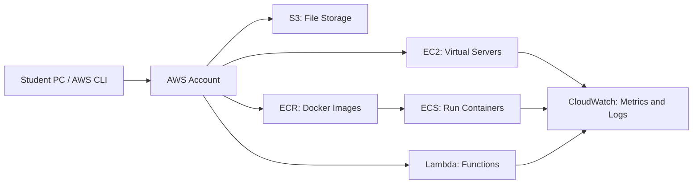
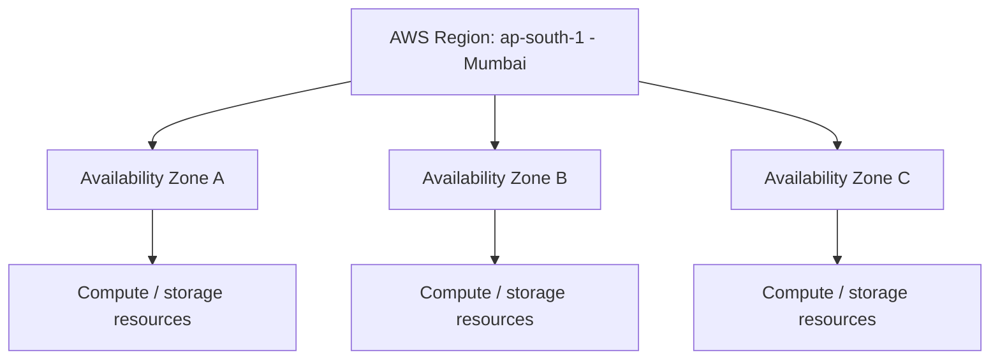
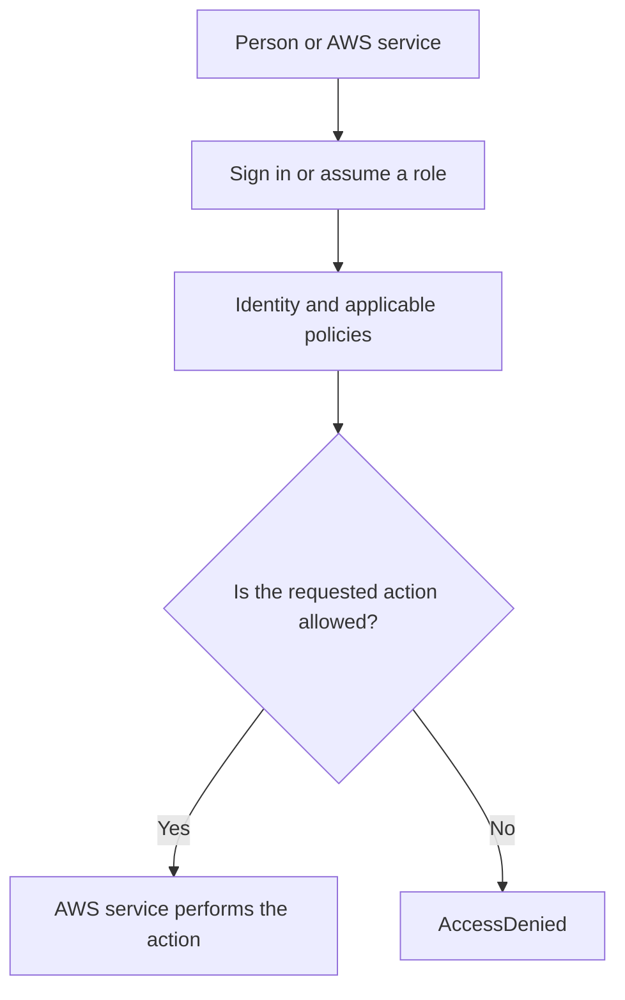
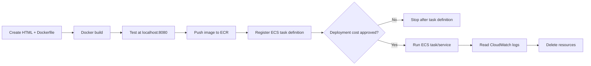

# AWS Cloud & DevOps: Beginner Practical README

**Updated:** October 2026 | **Audience:** Students and first-time AWS users | **Example Region:** `ap-south-1` (Mumbai)

> **Important:** AWS Free Tier does **not** mean every AWS service is free. New eligible customers may choose a Free plan with up to $200 in credits (subject to AWS eligibility and earning rules), lasting up to six months or until credits run out. The Free plan has limited service access. A Paid plan can generate charges. Always check your account's current Free Tier offers, Credits, Bills, and each service's pricing before launching resources: https://aws.amazon.com/free/.

## Contents

1. AWS overview and categorized service list (purpose, use case, real-world example)
2. AWS global infrastructure: time zones, Regions, Availability Zones
3. Free Tier eligibility and service costs
4. Create an AWS account and set cost controls
5. IAM fundamentals: identities, policies, roles and secure access
6. Connect AWS from local Windows PC using AWS CLI
7. EC2 Linux instance setup
8. S3 storage practical
9. ECR Docker registry practical
10. ECS container deployment overview
11. Lambda serverless practical
12. CloudWatch logs and monitoring
13. Combined project, troubleshooting, cleanup and exercises

## 1. AWS overview and service categories

Amazon Web Services (AWS) is a cloud computing platform. Instead of purchasing servers and storage, you use AWS resources on demand.

- **Region:** geographic area hosting AWS infrastructure; `ap-south-1` is Mumbai.
- **Availability Zone:** isolated infrastructure location within a Region.
- **IAM:** identity and permission management.
- **Console:** AWS web interface.
- **AWS CLI:** command-line tool for AWS operations.



### AWS services by category — purpose, use case, and real-world example

| Category | Service | What it does | When you would use it | Real-world example |
|---|---|---|---|---|
| Compute | **EC2** | Provides virtual servers | You need control over the operating system, installed packages, or long-running application | A company hosts a Java/Spring Boot API on a Linux server |
| Compute / serverless | **Lambda** | Runs code in response to an event without you managing a server | A small task should run on an upload, API request, schedule, or message | When a receipt image is uploaded to S3, Lambda creates a thumbnail or records metadata |
| Containers | **ECR** | Stores container images in a registry | You need a private place to store Docker images for deployment | A CI pipeline pushes `payments-api:1.4` to ECR after a successful build |
| Containers | **ECS** | Schedules and manages containerized applications | You want to run, scale, replace, and monitor containers without managing orchestration yourself | An online shop runs separate web and order-processing containers |
| Containers | **EKS** | Managed Kubernetes control plane | Your team needs Kubernetes APIs and ecosystem tooling | A platform team deploys many microservices using Kubernetes manifests and Helm |
| Storage | **S3** | Stores objects such as files, images, exports, and backups | You need durable object storage accessed through APIs or web apps | A learning portal stores assignment uploads and downloadable course materials |
| Storage | **EBS** | Provides block storage volumes for EC2 | A virtual machine needs a disk for its OS, application files, or database files | An EC2-hosted application keeps its attached application data on an EBS volume |
| Storage | **EFS** | Provides shared file storage for multiple compute clients | Several Linux instances need access to the same file system | Multiple web servers read shared user-uploaded files |
| Archive | **S3 Glacier storage classes** | Lower-cost storage for data accessed infrequently, with retrieval considerations | You need long-term retention rather than frequent interactive access | A business retains old reports and compliance archives |
| Database | **RDS** | Managed relational databases | Your application uses SQL and you want AWS to handle many routine database operations | An e-commerce application stores orders and customer records in PostgreSQL or MySQL |
| Database | **DynamoDB** | Managed NoSQL key-value/document database | You need low-latency access using known keys and flexible item attributes | A gaming service stores player session state or a shopping cart |
| Database | **ElastiCache** | Managed in-memory caching | You need fast access to frequently reused data | A website caches popular product details to reduce database load |
| Networking | **VPC** | Defines a logically isolated network | You need to control subnets, routes, and network boundaries | Separate public-facing components from private application/database subnets |
| Networking | **Elastic Load Balancing (ELB)** | Distributes incoming traffic across targets | You need to spread requests across healthy application instances or tasks | A load balancer routes website traffic to multiple web servers |
| Networking / DNS | **Route 53** | DNS and domain-routing services | You need to direct a domain name to an application endpoint | `www.example.com` resolves to the public endpoint for a website |
| CDN | **CloudFront** | Caches and delivers content through edge locations | Users in different locations need fast access to static or cacheable content | A media site delivers images, CSS, JavaScript, and video segments globally |
| API | **API Gateway** | Creates and manages API endpoints | You want managed HTTP/REST/WebSocket entry points for backend services | A mobile app calls an API Gateway endpoint backed by Lambda |
| Identity / security | **IAM** | Controls identities, roles, and permissions | A user or service needs only specific AWS actions | An ECS task role can read one S3 bucket without having administrator access |
| Identity | **IAM Identity Center** | Centralizes workforce access to AWS accounts and applications | A company needs managed employee sign-in and role-based account access | Developers sign in using an organization-managed portal and select a role |
| Security / encryption | **KMS** | Manages encryption keys and cryptographic operations | Data must be encrypted using managed keys and access controls | An application encrypts supported S3 objects or database resources with a KMS key |
| Secrets | **Secrets Manager** | Stores and manages secrets such as credentials and API keys | Applications need to retrieve secrets without hardcoding them in source code | A service retrieves a database password at runtime |
| Web protection | **WAF** | Filters web requests using configured rules | You need to block or rate-limit selected web traffic patterns | A public web application applies rules to reduce common malicious requests |
| Monitoring | **CloudWatch** | Collects metrics, logs, dashboards, and alarms | You need to diagnose behavior or be alerted when a metric crosses a threshold | A team checks Lambda errors and EC2 CPU utilization after a release |
| Audit | **CloudTrail** | Records AWS account/API activity | You need to investigate who performed an AWS action and when | An administrator reviews an unexpected security-group change |
| Operations | **Systems Manager** | Helps manage and operate supported AWS resources | You need remote operations, inventory, patching, or automation | An operations team runs a controlled command on managed EC2 instances |
| Infrastructure as code | **CloudFormation** | Creates and manages infrastructure from templates | You want repeatable environments instead of manual setup | A team deploys the same VPC, roles, and application resources to test and production |
| CI/CD | **CodeBuild** | Builds and tests source code | A pipeline needs a managed build environment | Each pull request triggers compilation and unit tests |
| CI/CD | **CodePipeline** | Orchestrates stages in a delivery pipeline | You want build, test, approval, and deployment stages connected | A commit starts a pipeline that builds an image and deploys it after approval |
| CI/CD | **CodeDeploy** | Automates supported application deployments | You need controlled application rollout to supported targets | A team deploys a new application revision to EC2 instances |
| Messaging | **SQS** | Queues messages between components | Producers and consumers should be decoupled and process work asynchronously | An order API queues invoice-generation jobs for a worker |
| Messaging | **SNS** | Publishes notifications to subscribers | One event needs to notify multiple subscribers | A monitoring alarm sends notifications to an operations subscription |
| Events | **EventBridge** | Routes events to targets using rules | Services should react to events without tight coupling | A scheduled rule invokes a housekeeping Lambda function |
| Workflow | **Step Functions** | Coordinates multi-step workflows | A process has multiple steps, retries, waits, or branches | An order workflow coordinates payment, inventory, and confirmation steps |
| Analytics | **Athena** | Queries data in S3 using SQL | You want to analyze stored files without managing a database server | An analyst queries application access logs stored in S3 |
| Analytics / ETL | **Glue** | Catalogs and transforms data for analytics | Data needs preparation before reporting | A scheduled job converts raw application data into analytics-ready datasets |
| Data warehouse | **Redshift** | Analytics data warehouse | You need large-scale analytical SQL queries | A company analyzes sales trends across years of transaction data |
| AI / ML | **Amazon Bedrock** | Provides access to foundation models through AWS services | You want to build generative AI features using supported models | A support portal drafts answers from approved knowledge content |
| AI / ML | **SageMaker AI** | Supports building, training, and deploying ML models | A team develops a custom predictive model | A retailer trains a demand-forecasting model |
| Billing | **Budgets / Cost Explorer** | Tracks costs and spending trends | You need to understand usage and be warned about budget thresholds | A student checks lab spending and receives a budget notification |

This is a representative learning list, not every AWS service. Names, capabilities, regional availability, and prices can change; check the official AWS service and pricing pages before using a service.

### The six services used in this handbook

| Service | Simple explanation | Typical use case | Practical example in this README |
|---|---|---|---|
| **EC2** | A virtual computer in AWS | Run a server or application with OS-level control | Launch Linux, install Apache, and open a test web page |
| **S3** | Online object/file storage | Store uploads, static assets, exports, and backups | Upload and download `notes.txt` privately |
| **ECR** | A private registry for container images | Store versioned Docker images so deployment services can pull them | Build a tiny Nginx image and push tag `1` to ECR |
| **ECS** | A service that schedules and runs containers | Deploy and maintain containerized services or one-off tasks | Create a task definition that refers to the image in ECR; deploy only after cost review |
| **Lambda** | Run a function in response to an event or invocation | Small event-driven tasks and APIs | Invoke a Python function from the Console and local AWS CLI |
| **CloudWatch** | Monitoring, logs, metrics, and alarms | Troubleshoot apps and observe resource health | Inspect Lambda logs and explore EC2 CPU metrics |

### Example: how these services work together in a real deployment

Imagine a small online store:

1. A developer builds the store's web application into a Docker image on a laptop.
2. A CI job uploads the versioned image to **ECR**.
3. **ECS** runs the container using compute capacity such as EC2 or Fargate.
4. Product photos and downloadable files are stored in **S3**.
5. A separate **Lambda** function processes a simple event, such as recording metadata when a file is uploaded.
6. **CloudWatch** collects application logs and metrics so developers can investigate errors.
7. **IAM** roles give each component only the permissions it needs.
8. A **VPC** and security groups define network boundaries.

For a real production system, a team may also add a database, load balancer, DNS, secrets management, backups, alarms, deployment approvals, and multi-AZ resilience. These are architecture choices, not automatically required for every small application.

## 2. AWS global infrastructure: time zones, Regions, and Availability Zones

Before creating resources, understand **where** an AWS resource runs and **what time** its logs or schedules use. These concepts help prevent deployment mistakes and make troubleshooting easier.

### 1.1 Time zone vs. Region vs. Availability Zone

| Term | Simple meaning | Example | Why it matters |
|---|---|---|---|
| **Time zone** | A regional offset/rule used to interpret local clock time | India Standard Time (IST) = UTC+05:30 | Helps interpret timestamps, schedule jobs, compare logs and coordinate teams |
| **UTC** | Coordinated Universal Time, a common reference clock | `2026-10-15 12:00 UTC` | Many AWS logs, APIs and monitoring timestamps use UTC or display timestamps in UTC; converting consistently avoids confusion |
| **AWS Region** | A separate geographic area where AWS provides services | Mumbai = `ap-south-1`; Singapore = `ap-southeast-1` | Selects the location where supported resources are created; affects latency, data residency, service availability and pricing |
| **Availability Zone (AZ)** | An isolated location/infrastructure group within a Region | A Region may offer AZ IDs such as `aps1-az1` | Spreading workloads across AZs can improve resilience if one AZ has a problem |
| **Edge location** | A location used by services such as CloudFront to deliver content closer to users | CloudFront point of presence | Can reduce content-delivery latency; it is not the same thing as choosing an EC2 Region/AZ |

**Remember:** A time zone is not an AWS Region. A Region is not an Availability Zone. `ap-south-1` is a Region identifier, not a time-zone name. The AWS Console may show a local time in its interface, but that does not change where a resource runs or the timestamp stored by a service.

### 1.2 Why should we choose a Region first?

Choose a Region before creating resources because:

1. **Latency:** choose a Region reasonably close to users or the systems that call the service.
2. **Availability:** not every AWS service or feature is available in every Region.
3. **Resilience:** for supported workloads, use multiple AZs within a Region when high availability is required.
4. **Data residency/compliance:** data may need to stay in a permitted geography; confirm your organization's requirements.
5. **Cost:** pricing and eligible offers can vary by Region and resource configuration.
6. **Consistency:** your CLI commands, S3 buckets, ECR repositories, Lambda functions and CloudWatch log groups must use the intended Region. A resource missing from the console may simply be in a different Region.

For this README, examples use **Mumbai (`ap-south-1`)**. You can use another Region if your instructor approves it and the required service is available there.

### 1.3 Why do Availability Zones matter?

A Region contains multiple Availability Zones. An AZ is designed to be isolated from failures in other AZs while connected to the Region through low-latency networking. A simple lab may use one AZ to reduce complexity; a production service may distribute instances or tasks across multiple AZs to keep working during an AZ-level issue.



The letters A/B/C above are explanatory labels, not guaranteed permanent names. AWS account-specific AZ names such as `ap-south-1a` can map differently between accounts; **AZ IDs** are consistent identifiers across accounts.

### 1.4 Why does time zone matter in AWS work?

Time is important when you read logs, schedule automation, compare events, set alarms or troubleshoot an application across countries.

- **Logs and debugging:** convert timestamps to one common time zone before deciding which event happened first. Many AWS service logs and API timestamps use UTC; check the particular service's display and documentation.
- **Scheduled jobs:** a task intended to run at 9:00 AM IST should be configured with the intended time zone or converted correctly to UTC. Do not assume every AWS scheduler interprets time in your laptop's local time zone.
- **Monitoring and incidents:** agree whether a team reports times in UTC or local time, and include the zone in incident notes.
- **Daylight-saving time:** some countries change clocks seasonally. India does not currently observe daylight-saving time, but UTC-based scheduling or an explicitly selected time zone helps when working with teams in other countries.
- **Local computer vs AWS:** your Windows clock/time zone does not automatically set the time zone of EC2, containers, Lambda runtimes, or AWS services. Each environment/application may have its own configuration.

**Example — IST and UTC:** IST is UTC+05:30. To convert `15:00 IST` to UTC, subtract 5 hours 30 minutes → `09:30 UTC`. To convert `09:30 UTC` to IST, add 5 hours 30 minutes → `15:00 IST`. Always include the date as well as the time, especially near midnight.

### 1.5 Check local time and AWS Region from Windows PowerShell

```powershell
# Show your computer's current local date/time and time zone
Get-Date
Get-TimeZone

# Show the AWS CLI profile's configured default Region
aws configure get region --profile student-lab

# Verify the AWS identity and account currently in use
aws sts get-caller-identity --profile student-lab

# List Regions available to the identity (permissions may restrict this)
aws ec2 describe-regions --query "Regions[].RegionName" --output table --profile student-lab
```

Set the CLI default Region for a named profile when appropriate:

```powershell
aws configure set region ap-south-1 --profile student-lab
```

This sets the default Region for that profile; commands can still override it with `--region`. It does **not** change the Windows time zone or move existing resources between Regions.

### 1.6 Keep a consistent time and Region in examples

Use explicit values in training commands so the intended target is clear:

```powershell
aws s3 ls --region ap-south-1 --profile student-lab
aws lambda list-functions --region ap-south-1 --profile student-lab
aws logs describe-log-groups --region ap-south-1 --profile student-lab
```

When comparing an event in a log with an event in an application, note the **timestamp, time zone (for example UTC or IST), Region, and resource name**. This avoids investigating the wrong Region or comparing timestamps in different zones.

---

## 3. AWS Free Tier: which services are free?

**AWS currently distinguishes Free and Paid account plans, promotional credits, and Always Free monthly allowances.** Availability and exact limits depend on account eligibility, Region and configuration. New eligible customers may receive $100 in initial credits and earn up to $100 more. The Free plan closes after six months or exhausted credits unless upgraded. Confirm terms on your sign-up screen.

| Service | Free Tier / cost interpretation | Student guidance |
|---|---|---|
| IAM | Standard IAM identity management generally has no separate charge | Enable MFA, least privilege |
| S3 | Some usage may be covered by offers/credits; requests, storage and transfer can cost | Store a tiny text file and remove it |
| EC2 | **Never assume a specific instance type is free**; compute, EBS and public IPv4 may cost | Check account-specific eligibility and estimate before launch |
| EBS | Storage may incur charges while EC2 is stopped | Delete orphaned volumes |
| ECR | Image storage/scanning/transfer may cost; verify allowance | Keep one small image |
| ECS (EC2 launch type) | ECS orchestration generally has no extra control-plane fee, but EC2/storage/network/logs cost | Do not assume free deployment |
| ECS (Fargate) | Fargate vCPU/memory/storage is **not automatically free** | Deploy only after cost approval |
| Lambda | Has an Always Free monthly requests/compute allowance; limits apply | Run a tiny function |
| CloudWatch | Some usage allowances exist; ingestion, retention, alarms and custom metrics may cost | Use short log retention |
| VPC | Basic VPC creation generally free; NAT gateways, public IPv4, endpoints and data transfer may cost | Avoid NAT gateways in basic labs |
| Budgets | Some budget features are available at no extra charge | Create billing alerts |

**Verify:** Console → Billing and Cost Management → Free Tier / Credits / Bills, and https://aws.amazon.com/free/. Do not treat a budget alert as a hard spending cap.

## 4. Create an AWS account

1. Visit **https://aws.amazon.com/free/** → **Create a free account**.
2. Provide email, account name and password; verify email and phone.
3. Provide contact and any payment/identity verification information requested.
4. Select **Free account plan** if eligible and suitable for learning; read the exact displayed terms.
5. Sign in at https://console.aws.amazon.com/.
6. Choose a Region (examples use **Mumbai / `ap-south-1`**).
7. Open Billing and Cost Management to inspect plan, credits and usage.

**Security checklist:** Enable root MFA; do not create root access keys; do not share passwords, access keys or payment details; use a least-privilege IAM role/user or IAM Identity Center.

### Cost protection

Console → **Billing and Cost Management → Budgets → Create budget**. Example: monthly budget of **US$1**, alerts at 50%, 80% and 100%. Alerts may be delayed and **do not automatically stop spending**. Check Bills, Credits and Free Tier regularly.

## 5. IAM fundamentals: identities, policies, roles and secure access

**IAM (Identity and Access Management)** is the AWS service that controls **who can sign in, which AWS resources they can access, and which actions they can perform**. Learn IAM before using the AWS CLI or creating resources. A user may be able to sign in successfully but still receive `AccessDenied` if their permissions do not allow an action.

### 5.1 IAM in simple terms

Imagine a college computer lab:

- **Identity** = a student or teacher who needs access.
- **Permission policy** = the rules describing what that identity is allowed to do.
- **Role** = a set of permissions that a trusted user or AWS service can assume temporarily.
- **Least privilege** = give only the access needed for the task, not every permission.

### 5.2 Main IAM concepts

| IAM concept | What it means | When it is used | Real-world example |
|---|---|---|---|
| **Root user** | The original account identity with broad account-level access | Account setup and a small number of account-management tasks | The account owner enables MFA and configures billing; daily work should not use root |
| **IAM user** | An identity in an AWS account that can have console or programmatic access | Legacy or specific learning setups that require a long-lived identity | A restricted lab identity is allowed to list objects in one training bucket |
| **IAM group** | A way to assign common permissions to multiple IAM users | Managing similar users together | A `Students` group receives the permissions needed for a supervised lab |
| **Policy** | A JSON document describing allowed or denied actions and resources | Controls which actions an identity or role can perform | A policy allows `s3:ListBucket` on one named training bucket |
| **IAM role** | An identity with permissions that a trusted principal can assume; commonly uses temporary credentials | AWS services or people need access without embedding long-term keys | An EC2 instance role allows an application to read a specific S3 bucket |
| **IAM Identity Center** | Centralized sign-in and role-based access to AWS accounts and applications | Organizations or training environments provide managed sign-in | A student signs into a portal, selects an account and role, then uses AWS CLI SSO |
| **MFA** | Multi-factor authentication adds a second proof of identity | Protects sign-in, especially the root user and privileged identities | A password plus an authenticator prompt/code |
| **Access key** | A credential pair for programmatic access | Only when a supported workflow explicitly requires it | A local CLI profile uses a restricted identity's credentials; prefer temporary credentials when possible |

### 5.3 How IAM authorization works



An allow in a policy is not always sufficient: explicit denies, organization policies, permission boundaries, resource policies, and trust relationships can also affect access. For beginner labs, understand the basics first and ask an administrator to review permissions rather than granting broad access.

### 5.4 Set up IAM safely after account creation

1. **Enable MFA for the root user:** use the account/security settings and follow AWS's current MFA instructions. Do not create root access keys.
2. **Choose the access method:** use IAM Identity Center and temporary credentials if your organization or lab provides them. For a personal account, follow AWS's current recommended sign-in and CLI credential method.
3. **If an instructor specifically requires an IAM user:** create a separate non-root identity, enable MFA for console sign-in, and attach only the permissions required for the exercise. Do not attach `AdministratorAccess` merely to avoid troubleshooting.
4. **Use roles for AWS workloads:** for example, EC2 and ECS applications should use an appropriate IAM role rather than storing access keys in source code or on the server.
5. **Never commit credentials:** keep `.aws/credentials`, private keys, tokens and `.env` files out of Git repositories.
6. **Review and remove unused access:** disable/delete old access keys and lab identities when no longer needed.

Official guide: https://docs.aws.amazon.com/IAM/latest/UserGuide/best-practices.html

### 5.5 First IAM practical: understand the active identity

After the CLI is configured in the next section, run:

```powershell
aws sts get-caller-identity --profile student-lab
aws configure list --profile student-lab
```

The first command displays the AWS account and identity associated with the active credentials. The second shows which profile settings are being used. If the identity is not the one expected, **stop before creating or deleting resources** and select the correct profile.

### 5.6 IAM examples for this handbook

| Practical | Permissions/role concept | Why it is needed |
|---|---|---|
| List/upload to S3 | Allow only the required S3 actions on the lab bucket | Avoid granting access to every bucket in the account |
| Push an image to ECR | Allow the required ECR authentication and repository upload actions | Docker needs permission to authenticate and upload the image |
| Invoke Lambda from CLI | Allow `lambda:InvokeFunction` on the named function | Invocation does not require full Lambda administration |
| View CloudWatch logs | Allow required CloudWatch Logs read actions | Students can inspect output without changing unrelated resources |
| Run an ECS task | Use an ECS task execution role to pull images and write logs; use a separate task role for application API calls | Separates deployment/runtime permissions from application permissions |
| Run code on EC2 | Attach an appropriate instance role when the application needs AWS access | Avoids saving long-lived access keys on the virtual machine |

The exact permissions depend on the commands and resources in the lab. Use AWS-managed policies only when appropriate, prefer narrower permissions for real workloads, and have an instructor/admin review the policy before deployment.

---

## 6. Connect AWS from local Windows PC

### Install AWS CLI v2

1. Follow the official installer guide: https://docs.aws.amazon.com/cli/latest/userguide/getting-started-install.html.
2. Install the Windows MSI, then open a **new PowerShell** window.
3. Verify:

```powershell
aws --version
aws help
```

For WSL/Linux, install the Linux version separately using the same official guide.

### Recommended: IAM Identity Center / temporary credentials

If your instructor or organization has configured IAM Identity Center:

```powershell
aws configure sso
# Enter the start URL, SSO Region, account, role and profile name provided by your administrator.
aws sso login --profile student-lab
aws sts get-caller-identity --profile student-lab
aws s3 ls --profile student-lab
```

**Do not invent an SSO URL.** Use one provided by the administrator. Personal accounts may use other AWS-supported short-term sign-in flows. If the lab explicitly uses IAM access keys, use a restricted **IAM user, never root**:

```powershell
aws configure --profile student-lab
# Supply access key, secret key, ap-south-1 and json when prompted.
aws sts get-caller-identity --profile student-lab
aws configure list --profile student-lab
```

Never commit credentials to Git. CLI profiles reside under `%UserProfile%\.aws\` on Windows. Revoke unused keys.

**Useful read-only commands:**

```powershell
aws ec2 describe-regions --profile student-lab
aws lambda list-functions --region ap-south-1 --profile student-lab
aws s3 ls --profile student-lab
```

`--profile` selects credentials; `--region` selects Region. `sts get-caller-identity` confirms the active AWS identity.

## 7. EC2: create and connect to a Linux virtual machine

**Cost warning:** EC2 compute, EBS disks and public IPv4 can cost money. Verify account eligibility and estimated monthly cost first.

### Console launch steps

1. Console → **EC2 → Instances → Launch instances**.
2. Name: `student-web-server`.
3. AMI: **Amazon Linux 2023**.
4. Instance type: choose an instance shown eligible under **your own account's current offer**, if available. **Do not assume `t2.micro` or `t3.micro` is free.**
5. Create a key pair and securely save its `.pem` private key.
6. Choose VPC/subnet. Public IP only if needed; check IPv4 charges.
7. Security group: allow **SSH port 22 from My IP only**. Allow HTTP port 80 only for this temporary web demo.
8. Choose a small EBS disk, check price, review estimated costs, then launch.

### Connect from Windows PowerShell

```powershell
ssh -i "C:\Users\YourName\Downloads\student-key.pem" ec2-user@YOUR_PUBLIC_IP
```

Amazon Linux usually uses `ec2-user`; Ubuntu usually uses `ubuntu`. Alternatively use **EC2 Instance Connect** when available. Keep `.pem` private and restrict file permissions.

### Install Apache on Amazon Linux 2023

```bash
sudo dnf update -y
sudo dnf install -y httpd
echo '<h1>Hello from AWS EC2!</h1>' | sudo tee /var/www/html/index.html
sudo systemctl enable --now httpd
sudo systemctl status httpd
curl -I http://localhost
```

Visit `http://YOUR_PUBLIC_IP` if port 80 is permitted. This uses HTTP for a temporary exercise, not a production deployment.

**Cleanup:** Terminate the instance; check EBS volumes, snapshots, elastic/public IPs and security groups. **Stopping EC2 may still leave storage and IP charges.**

## 8. S3: upload and download a file

**Use case:** Store a small class note in AWS object storage.

Console → **S3 → Create bucket**. Use a globally unique name such as `student-lab-UNIQUE-SUFFIX`, Region `ap-south-1`, and keep **Block all public access ON**.

```powershell
"Hello AWS S3" | Set-Content .\notes.txt
aws s3 cp .\notes.txt s3://YOUR_UNIQUE_BUCKET/notes.txt --profile student-lab --region ap-south-1
aws s3 ls s3://YOUR_UNIQUE_BUCKET/ --profile student-lab
aws s3 cp s3://YOUR_UNIQUE_BUCKET/notes.txt .\downloaded-notes.txt --profile student-lab
Get-Content .\downloaded-notes.txt
```

- `aws s3 cp` copies files to/from S3.
- `aws s3 ls` lists objects.
- Bucket names are globally unique, not just unique within your account.

**Cleanup:**

```powershell
aws s3 rm s3://YOUR_UNIQUE_BUCKET/notes.txt --profile student-lab
aws s3 rb s3://YOUR_UNIQUE_BUCKET --profile student-lab
```

Versioned buckets require deleting all versions and delete markers too.

## 9. ECR: build and push a Docker image

**Use case:** Store a Docker image for later deployment to ECS. ECR storage and scanning can incur charges.

Install Docker Desktop: https://docs.docker.com/desktop/setup/install/windows-install/ and check `docker --version`.

Create `index.html`:

```html
<!doctype html>
<html><body><h1>Hello from AWS Docker!</h1></body></html>
```

Create `Dockerfile`:

```dockerfile
FROM nginx:alpine
COPY index.html /usr/share/nginx/html/index.html
EXPOSE 80
```

Build and test **locally first**:

```powershell
docker build -t aws-student-web:1 .
docker run --rm -d --name student-web -p 8080:80 aws-student-web:1
# Open http://localhost:8080
docker stop student-web
```

Create ECR repository, authenticate Docker and push:

```powershell
$Region = "ap-south-1"
$Profile = "student-lab"
$AccountId = aws sts get-caller-identity --query Account --output text --profile $Profile
$Repo = "aws-student-web"
$Registry = "$AccountId.dkr.ecr.$Region.amazonaws.com"
aws ecr create-repository --repository-name $Repo --region $Region --profile $Profile
aws ecr get-login-password --region $Region --profile $Profile | docker login --username AWS --password-stdin $Registry
docker tag aws-student-web:1 "${Registry}/${Repo}:1"
docker push "${Registry}/${Repo}:1"
aws ecr describe-images --repository-name $Repo --region $Region --profile $Profile
```

- `docker build`: creates a local image.
- `docker run`: tests the image locally.
- `ecr create-repository`: creates an image repository.
- `docker login`: authenticates Docker to ECR.
- `docker tag`: assigns a remote image address.
- `docker push`: uploads the image.

## 10. ECS: run a container from ECR

**Use case:** ECS orchestrates containers using compute capacity. **ECS does not make the underlying compute free.** ECS on EC2 uses EC2 resources; ECS on Fargate incurs Fargate resource charges. Networking, public IPs, load balancers and CloudWatch may add charges.

### Console walkthrough (only with cost approval)

1. ECS → **Clusters → Create cluster**; review compute and networking costs.
2. ECS → **Task definitions → Create**; family `student-web-task`.
3. Container name `web`; image `ACCOUNT_ID.dkr.ecr.ap-south-1.amazonaws.com/aws-student-web:1`; container port `80`.
4. Configure a correctly scoped **task execution role** for ECR pulls and CloudWatch Logs; a separate **task role** only if application code calls AWS APIs.
5. Choose compatible CPU, memory, network mode, subnets and security groups.
6. Configure `awslogs` and a log group, such as `/ecs/student-web`.
7. Register the task definition. Only run a task/service if compute and network costs have been approved.
8. Inspect ECS task status/events and CloudWatch logs. Delete resources afterward.

### Example Fargate task definition — **not free by default**

Save as `task-definition.json` and replace placeholders:

```json
{
  "family": "student-web-task",
  "networkMode": "awsvpc",
  "requiresCompatibilities": ["FARGATE"],
  "cpu": "256",
  "memory": "512",
  "executionRoleArn": "arn:aws:iam::ACCOUNT_ID:role/ecsTaskExecutionRole",
  "containerDefinitions": [{
    "name": "web",
    "image": "ACCOUNT_ID.dkr.ecr.ap-south-1.amazonaws.com/aws-student-web:1",
    "essential": true,
    "portMappings": [{"containerPort": 80, "protocol": "tcp"}],
    "logConfiguration": {
      "logDriver": "awslogs",
      "options": {
        "awslogs-group": "/ecs/student-web",
        "awslogs-region": "ap-south-1",
        "awslogs-stream-prefix": "ecs"
      }
    }
  }]
}
```

The role and log group must exist; the image must be pushed; deployment requires a cluster, networking and a valid task/service configuration. This JSON is an educational example, **not a zero-cost deployment guarantee**.

```powershell
aws ecs register-task-definition --cli-input-json file://task-definition.json --region ap-south-1 --profile student-lab
aws ecs list-task-definitions --region ap-south-1 --profile student-lab
```

Registering a task definition **does not start a running container**. Avoid NAT gateways and load balancers in cost-sensitive labs.

## 11. Lambda: first serverless function

**Use case:** Return a personalized greeting without managing a server. Lambda has an Always Free monthly allowance subject to limits; CloudWatch logging and other dependencies can still have costs.

Console → **Lambda → Create function → Author from scratch**:
- Name: `student-hello-lambda`.
- Runtime: currently supported Python 3.x version.
- Execution role: a least-privilege role with basic CloudWatch Logs permissions.
- Timeout: 3 seconds; no VPC for this simple example.

Paste, **Deploy**, then **Test**:

```python
import json

def lambda_handler(event, context):
    name = event.get("name", "Student")
    return {
        "statusCode": 200,
        "body": json.dumps({"message": f"Hello, {name}!"})
    }
```

Test event:

```json
{"name": "DevOps Learner"}
```

Invoke from Windows PowerShell:

```powershell
'{"name":"Local Student"}' | Set-Content -Encoding ascii .\event.json
aws lambda invoke --function-name student-hello-lambda --cli-binary-format raw-in-base64-out --payload file://event.json --region ap-south-1 --profile student-lab .\lambda-output.json
Get-Content .\lambda-output.json
```

`lambda invoke` calls the function; `--payload` supplies JSON input; output is written to the named file.

**Cleanup:** Delete function and unused dedicated CloudWatch log group.

## 12. CloudWatch: logs, metrics and alarms

**Use case:** Troubleshoot Lambda and ECS, view EC2 CPU usage and receive alerts.

| CloudWatch feature | Meaning | Example |
|---|---|---|
| Metrics | Measurements over time | EC2 `CPUUtilization` |
| Logs | Runtime/application messages | Lambda function logs |
| Log groups | Organize log streams | `/aws/lambda/student-hello-lambda` |
| Alarms | Notify on metric conditions | CPU above a threshold |
| Dashboards | Visualize monitoring | CPU + invocation chart |

Add logging to your Lambda function:

```python
import logging
logger = logging.getLogger()
logger.setLevel(logging.INFO)

def lambda_handler(event, context):
    logger.info("Student lab invocation received")
    return {"statusCode": 200, "body": "OK"}
```

Deploy, invoke, then open **CloudWatch → Logs → Log groups → `/aws/lambda/student-hello-lambda`**.

```powershell
aws logs describe-log-groups --log-group-name-prefix "/aws/lambda/student-hello-lambda" --region ap-south-1 --profile student-lab
aws logs tail "/aws/lambda/student-hello-lambda" --since 10m --region ap-south-1 --profile student-lab
```

**EC2 alarm exercise:** CloudWatch → Alarms → Create alarm → EC2 `CPUUtilization` → choose instance → threshold such as >70%; review alarm/SNS pricing. An alarm **does not automatically shut down billable resources**. Set short log retention for lab groups.

## 13. Combined practical mini project

**Project:** HTML page → Docker image → ECR → ECS → CloudWatch.



**Student submissions:** `Dockerfile`, `index.html`, screenshot of local Docker page, ECR image name, task definition JSON, optional approved ECS/CloudWatch screenshots, cleanup evidence.

### Troubleshooting

| Error | Likely cause | What to check |
|---|---|---|
| `aws` not recognized | CLI not installed/PATH | Reopen terminal, verify installation |
| `Unable to locate credentials` | Missing profile | `aws configure list --profile student-lab` |
| `ExpiredToken` | Session expired | `aws sso login --profile student-lab` |
| `AccessDenied` | Insufficient IAM permissions | Confirm identity and least-privilege policy |
| `NoSuchBucket` | Wrong bucket/Region | Verify bucket spelling and Region |
| ECR Docker login fails | Wrong Region/account or permission | Verify STS identity and ECR permissions |
| ECS task stops | Role, image, capacity, networking, logs | Inspect ECS stopped reason and events |
| EC2 SSH times out | Security group, route, IP | Check port 22 from your IP and connectivity |
| Lambda fails | Handler/runtime/role/input | Check test output and CloudWatch logs |

### Mandatory cleanup checklist

- [ ] Terminate unused EC2 instances.
- [ ] Delete orphaned EBS volumes, snapshots and unused elastic/public IP allocations.
- [ ] Delete S3 objects, versions and buckets.
- [ ] Stop/delete ECS services and tasks, and remove unneeded clusters.
- [ ] Delete ECR images and repositories.
- [ ] Delete Lambda lab functions.
- [ ] Delete unused CloudWatch log groups, alarms and notifications.
- [ ] Check for load balancers, NAT gateways, endpoints and other networking costs.
- [ ] Revisit **Billing → Bills / Credits / Free Tier**; reporting can be delayed.
- [ ] Revoke unused access keys and protect local `.pem` files.

### Student review questions

1. What is the difference between AWS Region and Availability Zone?
2. Why should root credentials not be used for the AWS CLI?
3. What is the difference between Free plan credits and Always Free allowances?
4. Compare EC2 and Lambda with an example.
5. Compare S3 and EBS.
6. What does `aws sts get-caller-identity` verify?
7. Why use `docker tag` before `docker push`?
8. What is the difference between ECR and ECS?
9. Why can ECS Fargate cost money?
10. Where can Lambda logs be viewed?
11. Why might a stopped EC2 instance still incur charges?
12. Why are budget alerts not hard cost caps?

## Official references

- [AWS Free Tier](https://aws.amazon.com/free/)
- [AWS Free Tier plans](https://docs.aws.amazon.com/awsaccountbilling/latest/aboutv2/free-tier-plans.html)
- [AWS CLI install](https://docs.aws.amazon.com/cli/latest/userguide/getting-started-install.html)
- [AWS CLI SSO](https://docs.aws.amazon.com/cli/latest/userguide/cli-configure-sso.html)
- [IAM best practices](https://docs.aws.amazon.com/IAM/latest/UserGuide/best-practices.html)
- [EC2 getting started](https://docs.aws.amazon.com/AWSEC2/latest/UserGuide/EC2_GetStarted.html)
- [S3 getting started](https://docs.aws.amazon.com/AmazonS3/latest/userguide/GetStartedWithS3.html)
- [ECR getting started](https://docs.aws.amazon.com/AmazonECR/latest/userguide/getting-started-cli.html)
- [ECS documentation](https://docs.aws.amazon.com/AmazonECS/latest/developerguide/Welcome.html)
- [Lambda getting started](https://docs.aws.amazon.com/lambda/latest/dg/getting-started.html)
- [CloudWatch documentation](https://docs.aws.amazon.com/AmazonCloudWatch/latest/monitoring/WhatIsCloudWatch.html)
- [AWS Pricing Calculator](https://calculator.aws/)

> **Instructor note:** Recheck Free Tier terms, eligible resources, supported runtimes, and service pricing on the day of class. Students should not upgrade to a Paid plan solely to complete a beginner exercise without understanding charges.
